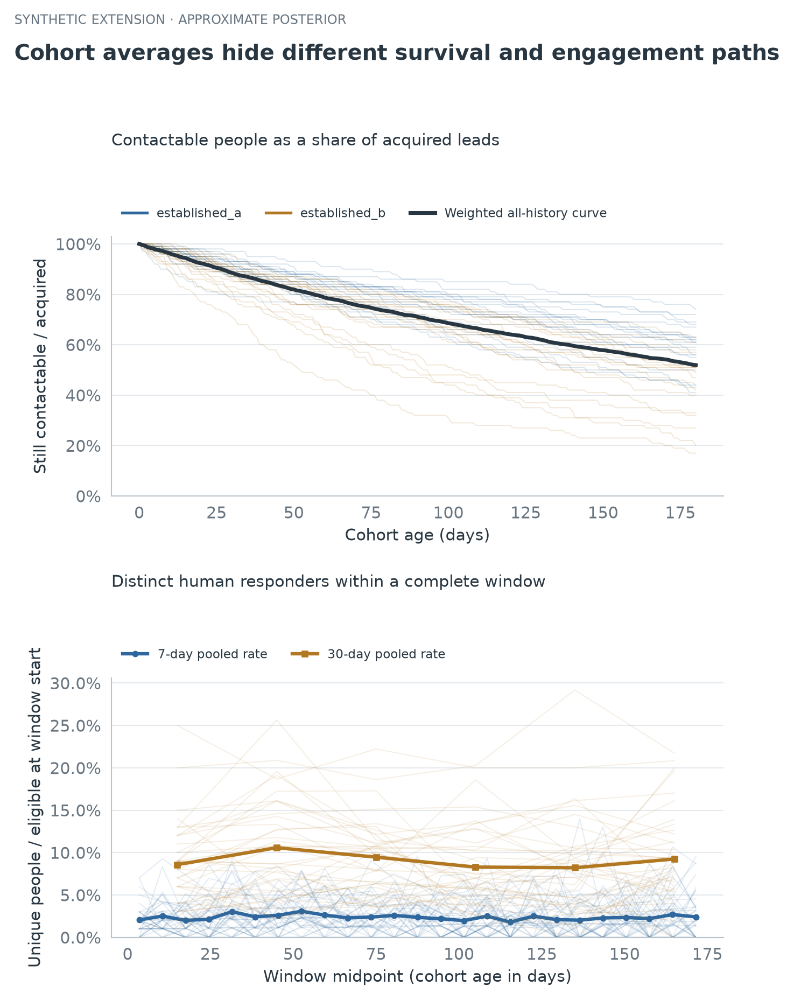
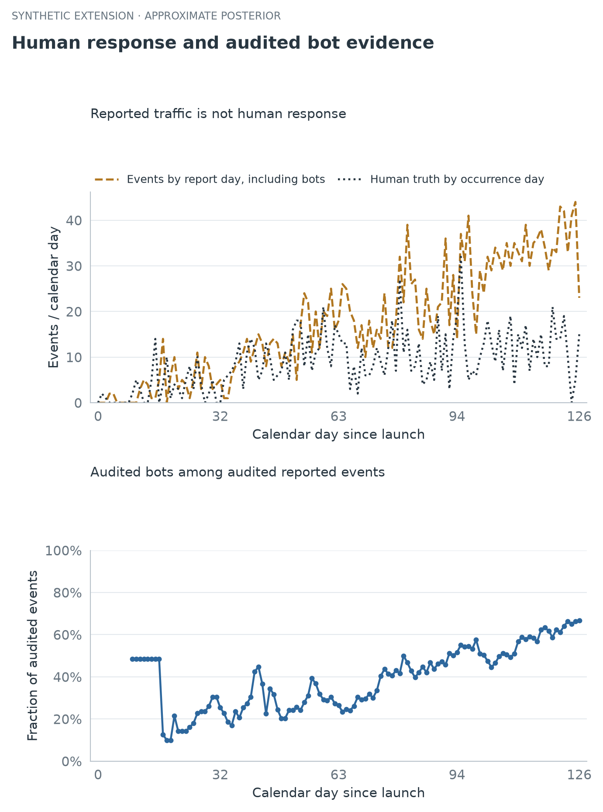
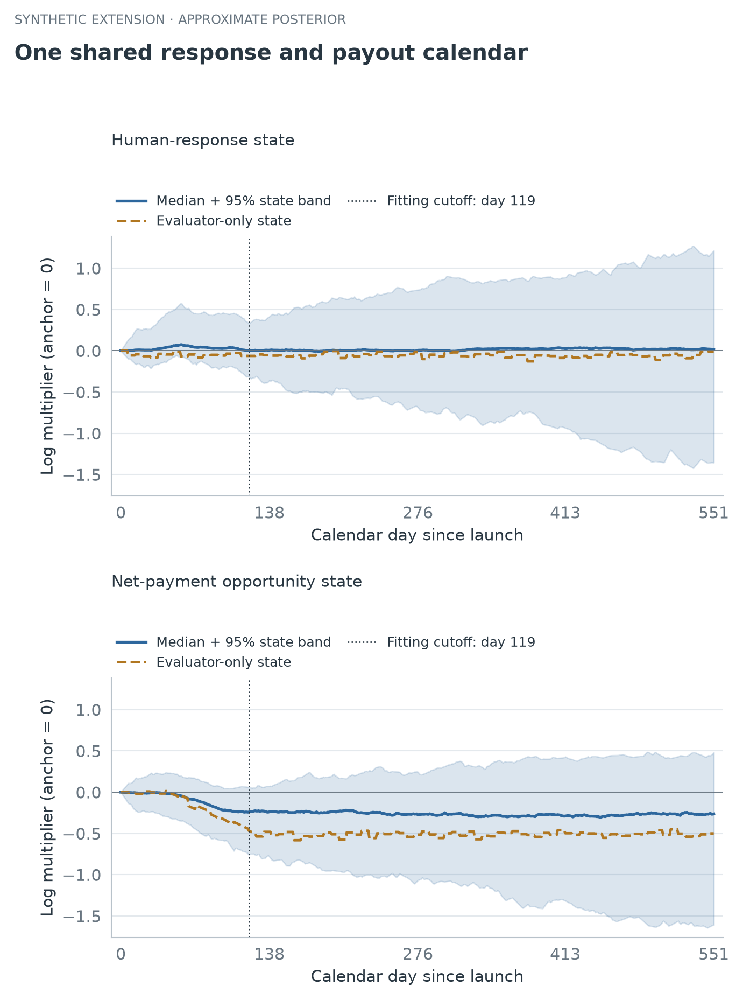
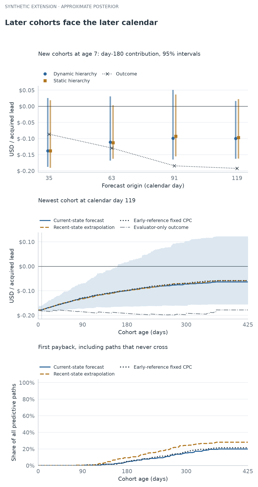
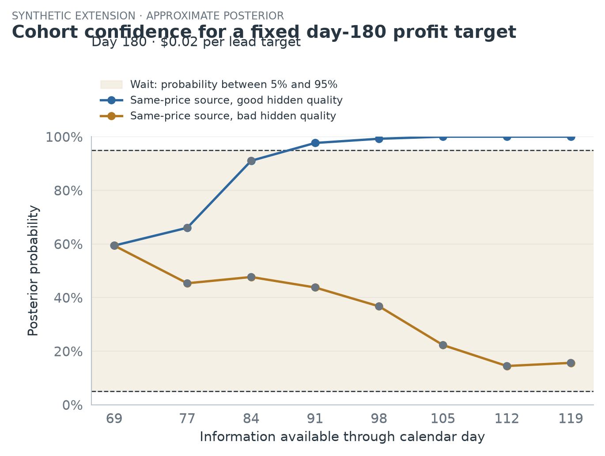
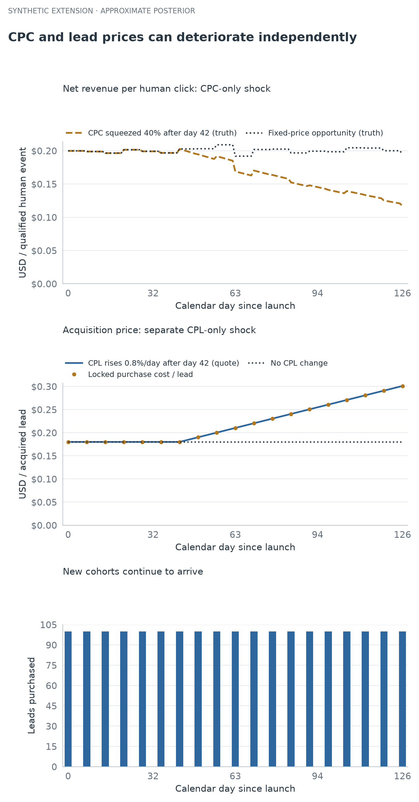
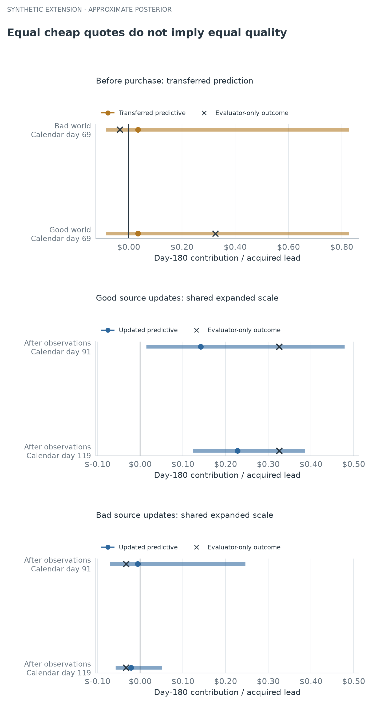
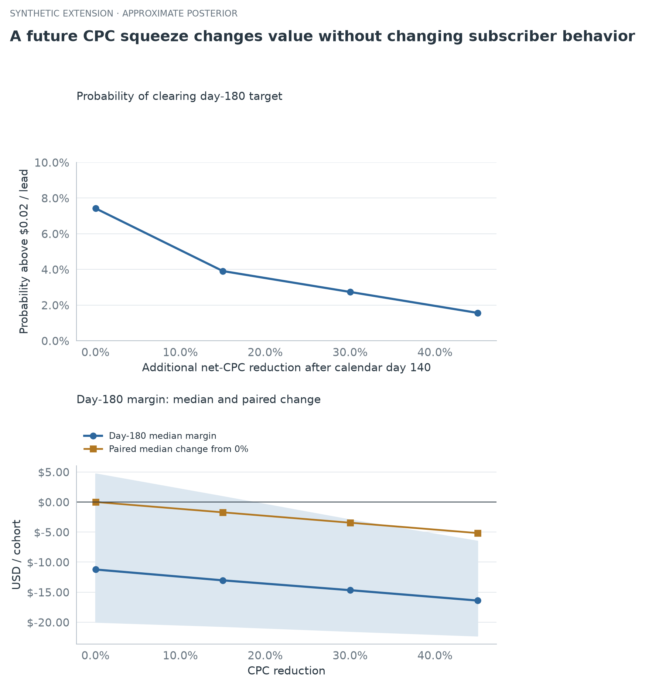
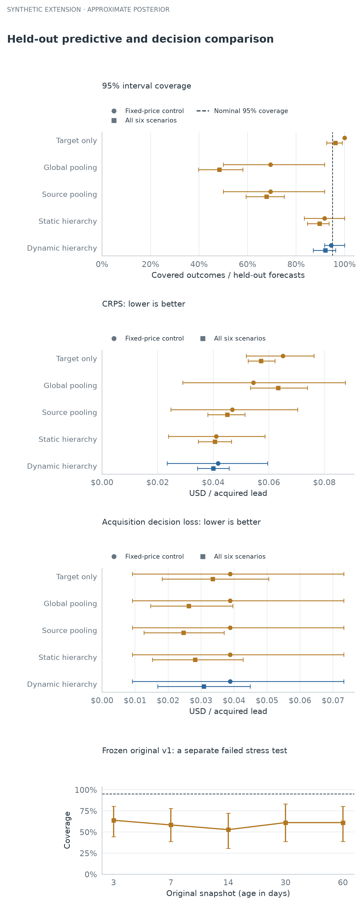
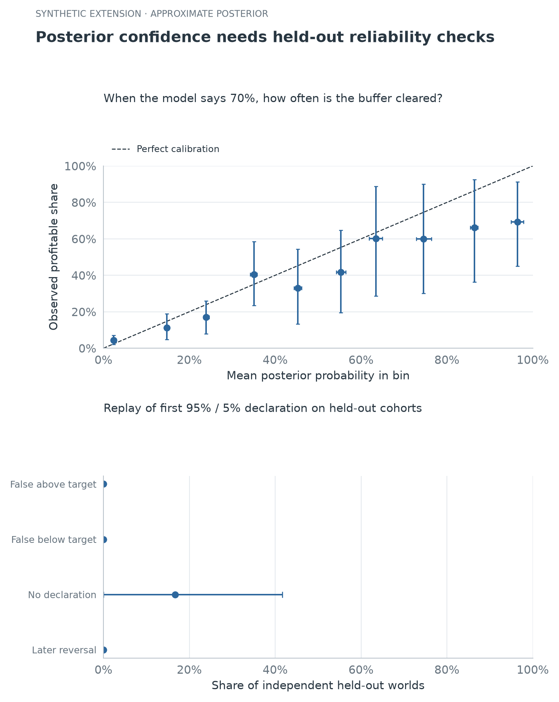

# When does an email subscriber pay for itself?

At DealNews, I started a project I didn't have time to finish. I wanted to use Bayesian statistics and decision theory to understand the economics of paid email leads.

Buying a lead creates a cost today and uncertain revenue later. I wanted to follow what happened to the acquired cohort, then decide when the evidence supported calling it profitable. A smooth average or a positive expected return wouldn't answer that on its own.

I rebuilt the problem as a reproducible simulation. The starting point is people: whether an address stays contactable, whether a person responds, and how many clicks that response produces. Money comes next. Then I can ask how the answer changes when click revenue falls, acquisition costs rise or a new source arrives.

**Every modeled subscriber, price, event and outcome here is fictional. No DealNews records or historical campaign results enter this experiment. This is a draft demonstration, not a validated acquisition policy.**

## Follow the people in each cohort

Each thin curve below represents a weekly acquisition cohort. Subscribers keep the same human or bot status and individual activity traits through their simulated lives. They can leave the contactable population, and cohorts have different contactability half-lives.

Contactability and engagement answer different questions. The contactable fraction counts addresses still available to send to, divided by the original acquired leads. It includes both humans and bots. A distinct-human response rate counts people who responded during a stated window. A person can remain contactable without responding, or respond in one window and return in another.

The exported detail includes 38 cohorts and 950 complete seven-day cohort windows. Each window counts a person once and divides by the contactable population at the window start. The pooled curve adds numerators and denominators before dividing; thin paths preserve cohort variation rather than hiding it in an average.



*Figure 07. Synthetic evaluator truth only (demo-cpc_squeeze-884000, cpc_squeeze). Thin lines are individual weekly acquisition cohorts; the heavy survival curve pools numerator and original-acquired-lead denominator at each age. The lower panel deduplicates each person across a complete 7- or 30-day window; its denominator is the contactable population at window start. The heavier rates pool counts (sum distinct responders / sum eligible), not averages of cohort percentages. Windows are overlapping views of the same synthetic people, not independent evidence. All cohorts are fictional and full windows only.*

This first chart uses the simulator's complete evaluator history so the underlying cohort behavior is visible. It is a descriptive view of the fictional people, including their later outcomes. The fitted model does not receive those truth curves or unseen future observations.

The response windows deduplicate people across the entire window. Someone who clicks on several days still counts once within that window. A longer window gives someone more chances to respond, so a higher monthly rate than weekly rate does not by itself mean retention improved.

## Understand what the aggregate hides

The heavy survival curve summarizes the same cohorts as the thin lines, weighting by original acquired leads. The pooled response rate adds distinct responders across cohorts and divides by the corresponding population contactable at each window's start. It is a ratio of pooled counts, rather than an unweighted average of cohort percentages.

The weekly and monthly response summaries are complete age windows within cohorts. The all-history survival curve pools cohorts at the same age. These are different summaries, with different denominators. The exported tables retain cohort counts, window boundaries and the raw denominators.

These are also overlapping views of the same people. They are not independent new evidence. A quieter aggregate curve can make the overall pattern easier to see while concealing differences between sources and acquisition cohorts.



*Figure 02. Synthetic illustration of reported-event counts, evaluator-only true-human events, and the fraction of audited events labeled bot. Audits arrive with a lag; audit counts are the denominator. True-human events are hidden evaluator truth, not an input to model fitting. The model assumes the declared audit sensitivity, specificity and representative-selection process.*

Aggregation is separate from statistical pooling. The Bayesian model estimates distinct cohort behavior while sharing evidence through a source and a learned population. A new cohort borrows information from its source but keeps uncertainty about its own performance. A new source gets fresh source and cohort variation instead of inheriting an established source's posterior.

Every information cutoff refits the records available then from the same fixed hyperprior. Earlier records are not counted again by multiplying a previous posterior by the whole historical likelihood.

## Translate activity into contribution

For cohort c at age h, contribution is:

```text
M_c(h) = attributed net revenue through h
         - acquisition cost
         - sending cost through h
```

This excludes fixed overhead. Acquisition cost belongs to the purchased cohort. Sending cost depends on the contactable addresses under the declared sending policy. Repeat human clicks can produce revenue even though each responding person counts once in a unique-response window.

The synthetic sender mails each contactable address once per day. Humans can create repeat clicks and revenue; bots are counted separately and earn no human CPC. Acquisition cost is booked once, while send costs follow contactable addresses. This separates survival, unique people, repeat activity and economics under explicit assumptions.

First payback is the first age when contribution crosses zero. Positive contribution at a fixed target age and staying positive afterward are separate outcomes. Every predictive path remains in the payback denominator, including paths that never cross under the finite policy.

Reported history is incomplete at an information cutoff. Contactability, response reports, audit labels and monetary observations have declared visibility rules. Missing labels and pending payments are unavailable information, not zero outcomes. Complete economic paths can impute pending past activity, so they need not pass through a partially visible reported balance.

Event time and report time differ: reported events arrive after two days, audit labels after seven, and mature revenue and human-count summaries after fourteen. A forecast at a cutoff uses only information visible by then. Evaluator truth is kept separately to compare predictions with eventual simulated outcomes.



*Figure 03. One synthetic world, refit through calendar day 119. The state bands show the approximate posterior before the cutoff and conditional future-state prediction afterward. These shared log-scale calendar states are not contribution intervals; their interpretation depends on the model's age, calendar and cohort assumptions.*

The forecast includes uncertain cohort behavior and future event and payment variation. A band around a fitted expected retention curve describes something different from a band for the realized contribution of a finite cohort. The figures and tables identify which quantity they display.



*Figure 04. Posterior predictive contribution per acquired lead under several calendar assumptions. The payback curve keeps every simulated path in its denominator, including paths that never cross zero by day 425. First payback, positive contribution at day 180 and staying positive are different outcomes. Conditional future-state paths are scenarios, not probabilities that those futures will occur.*

## Keep the cohort and the outcome fixed as evidence arrives

For the profitability decision, I select one cohort and keep its target age fixed. Only the information cutoff changes. Otherwise, a line could appear to show learning when it was actually switching to different cohorts.

I also choose a minimum contribution per originally acquired lead. In shorthand:

```text
p_c(T) = P(M_c(H) / N_c > delta | records available at T, future scenario)
```

Here H is the fixed target age, N_c is the original cohort size and delta is the margin target. This probability concerns the cohort's realized contribution, not just whether its expected contribution is positive.

At each information cutoff I classify a cohort as above target only when its posterior probability is at least 95%, and below target only when it is at most 5%. The target is day-180 contribution above $0.02 per originally acquired lead. Values between the thresholds remain unresolved. Those probability cutoffs are a decision convention, not a claim of 95% empirical accuracy.



*Figure 08. Two equally priced fictional sources share the same prelaunch evidence and first receive the same prediction. As the same fixed day-70 cohort in each world accumulates observations, probabilities update toward different outcomes. Each point refits only records available at that cutoff and forecasts the same day-180 contribution under hold-current future conditions. The threshold is two cents of margin per originally acquired lead. A classification is above target at p≥95%, below target at p≤5%, inconclusive otherwise. This is a model probability, not validated 95% reliability; repeated cutoffs are dependent and later evidence can reverse the classification. It is separate from first-payback-by-day-425.*

The same day-70 cohort's probability evolves as evidence accumulates, while acquisition age and the day-180 target stay fixed. New-source quality remains unknown before launch; after observations arrive, the hierarchical model updates its population, source and cohort components with partial pooling.

For an already acquired cohort, the labels describe whether it is likely to finish above or below the declared target. Below target does not necessarily mean a cash loss: a small positive margin can still miss the required buffer. A prospective purchase can use the same probability threshold as an illustrative buy, skip or wait rule.

The probability can move in either direction as evidence arrives. Sampling error also matters near a threshold. A reported zero or complete success rate means none or all of the sampled predictive paths cleared the target; it does not establish certainty.

“Wait” marks an unresolved classification here. The acquisition-loss calculation treats it as a current nonpurchase. It does not optimize the value of another observation, a later quote or a delayed purchase. Continuing to send to an existing cohort is a separate decision because its acquisition cost is already sunk.

## Change the economics while keeping the comparison clear

The control has no systematic CPC squeeze, acquisition-price inflation or calendar deterioration in human quality. It still has subscriber variation, cohort variation and shared weekly disturbances.

The benchmark worlds then isolate mechanisms:

- A CPC squeeze reduces net revenue per human click while preserving the paired subscriber, engagement and click paths.
- A CPL increase raises the price of later acquisitions. It does not alter old purchase costs or make the fitted source quality worse.
- Human and bot deterioration changes the acquired human share by cohort vintage, human engagement over calendar time and bot activity. It does not currently add a calendar trend to the contactability exit hazard.
- A new cheap source introduces unfamiliar engagement quality. A low quote changes its economics without revealing whether its subscribers will respond well.

These are separate benchmark worlds, not one cumulative scenario containing every change. Age and calendar time still differ: two cohorts observed at the same age can face different prices and response conditions.

The model learns historical calendar conditions from available observations. Holding the fitted current state, extrapolating recent state slopes or restoring a learned early-price reference are conditional future assumptions. None reveals which future will occur. Zero drift in log prices does not imply a constant arithmetic mean price.

Figure 1 isolates CPC decline, later CPL inflation, and human/bot deterioration in separate paired synthetic worlds. A later quote does not reprice existing cohorts. Figure 6 tests the resulting predictions against held-out worlds.



*Figure 01. Paired controls isolate a CPC squeeze from rising CPL and later purchasing. Net-human CPC opportunity is evaluator-only truth; fitting does not receive it as a contract rate. Existing purchase costs remain fixed when a later quote changes.*



*Figure 05. Before purchase, the prediction integrates the global hierarchy with fresh source and cohort variation. Equally cheap sources start with the same uncertainty, then different observations update their source quality. Crosses are evaluator-only outcomes. The offer-price table changes only the cost of a prospective batch while keeping quality and outcome draws fixed.*

## Ask what a future price cut would change

The next chart takes one fitted forecast and applies additional future CPC reductions. It reuses the same posterior draws and random outcome paths. Contactability, unique engagement, repeat clicks, acquisition cost and sending costs stay fixed within each paired comparison. Only future net revenue per human click changes.

That makes the monetary difference interpretable. It is the effect of the stated price assumption inside this simulation, rather than a change in the people being compared.



*Figure 09. Conditional what-if for a planned existing-source cohort, fitted on day 119 and acquired day 126. The model applies an additional 0–45% net-CPC drop beginning day 140 and ramping for 28 days. Each point reuses the same posterior draw and random revenue-mark path: contactability, humans, engagement, click counts, purchase cost, send costs and shared uncertainty are held fixed. Only post-shock revenue per human event changes. The blue band is a 90% draw interval for margin; amber shows the paired median margin difference. The probability axis starts at zero and is scaled to the plotted range; exact probabilities are in the table. Scenario probabilities are not a forecast that a given squeeze will occur.*

For a planned 100-lead established_b cohort, a 30% future CPC reduction changes median day-180 contribution by −$3.45 for the whole cohort relative to no extra squeeze (paired 90% range −$7.52 to −$1.40). The chance of clearing the two-cent-per-lead buffer moves from 7% to 3%, with fitted draws and subscriber activity held in common. This scenario starts after the cutoff and leaves past clicks, subscriber activity and acquisition costs fixed.

The shock begins after the information cutoff and does not reprice earlier booked clicks. The margin interval describes possible cohort outcomes conditional on each shock. It does not assign a probability to that shock occurring.

A separate offered-CPL query changes only the purchase price of a prospective batch, keeping inferred quality and outcome draws fixed. Historical acquisition costs stay fixed. The [offered-cost table](tables/offered-cost.csv) retains the prospective prices, forecast margins, buffer probabilities and shortfall measures.

For a prospective 100-lead batch offered at $0.10 per lead, estimated probability of clearing the fixed day-180 target is 96% for the good source and 12% for the bad source. The offer-price table changes only purchase cost; inferred quality and outcome draws stay fixed.

## Check whether the confidence deserves trust

An illustrative probability threshold is easy to implement. Its reliability has to be measured separately.

The held-out replay forecasts fictional worlds that were not the illustration. One check groups forecasts by predicted probability and compares those predictions with the eventual share clearing the same margin target. Another follows one purchased cohort through prespecified information cutoffs, records its first decisive classification and compares that declaration with its eventual outcome.



*Figure 06. Uncertainty is clustered by independent synthetic world. Only three worlds represent each mechanism and eighteen worlds appear overall, so comparisons are exploratory. The historical v1 stress failure is a separate experiment, not pooled with the refreshed model.*



*Figure 10. All points come from held-out synthetic worlds, separate from the illustrative world. The upper panel bins fixed day-180 probabilities for clearing a $0.02/lead margin buffer and compares average forecast probability with observed profitability. Error bars bootstrap independent worlds, not correlated rows; forecast and world counts are in the numeric table. The lower panel replays the first weekly 95%/5% declaration for the same purchased cohort in each world. “False profitable/unprofitable” compare that first declaration with the eventual day-180 outcome; “no declaration” is allowed; “later reversal” records changed classification after first declaration. Small world counts and approximate likelihoods limit the strength of calibration claims.*

Across 18 independent held-out worlds, nominal 95% contribution intervals covered 92.0% of outcomes for the dynamic model under equal-world averaging (world-bootstrap 95% interval 87.0%–96.2%), versus 89.6% for the static hierarchy. Weighting forecast rows gives 93.5% dynamic coverage. The dynamic point estimate is below nominal, though its broad world-bootstrap interval includes 95%; this small experiment cannot establish precise calibration. Dynamic CRPS was $0.040 per lead versus $0.041 for the static hierarchy, with overlapping uncertainty intervals. Decision loss was $0.031 versus $0.028 per lead, with the static point estimate lower. Neither average score validates a decision rule. In the highest predicted-probability bin, the mean forecast was 96.4% while 69.2% of outcomes cleared the buffer; the observed-share world-bootstrap interval was 45.0%–91.2% (13 independent worlds, 132 nested forecasts). A high posterior cutoff is therefore an illustrative policy convention here, not a validated 95%-reliable business decision. In the weekly replay of one already-acquired established cohort, the first declaration was below-target in 10 of 12 independent worlds; 0 were above-target and 2 stayed unresolved. There were 0 false below-target declarations and 0 later reversals in this small replay. It does not test a positive-purchase decision and is not policy validation.

The fixed-cohort replay separately reports false above-target calls, false below-target calls, no-decision cases, and reversals after an earlier decisive call. These answer both whether the threshold was reached and whether that early classification agreed with eventual hidden outcomes.

False above-target and false below-target declarations, unresolved cases and later reversals all matter. Sequential error rates here use the evaluated worlds as their denominator. They should not be mistaken for the fraction of above-target declarations that proved wrong. A reversal means a later decisive classification on the opposite side, not simply a return to the inconclusive band.

Repeated cohorts and cutoffs within a world are dependent. Evaluation uncertainty resamples independent worlds, and the tables retain both world and forecast counts. Sparse probability bins cannot establish reliability from an attractive-looking point. Predictive interval coverage and profitability-probability calibration also measure different things; both need checking.

The previous experiments remain part of the record:

The earlier v1 stress test remains a separate historical result: nominal 95% intervals covered 56.5% in its frozen 12-world stress suite. That is a failure of the earlier model and should not be confused with the refreshed subscriber model's reliability results.

Those are results from earlier specifications. They are not the coverage or reliability of the subscriber model described here. The refreshed results must stand on their own, including any new failures. Choosing a threshold does not repair a misspecified likelihood.

## Keep the model's limits visible

The implementation fits approximate Gaussian measurements for contactability exits, daily unique response, repeat events and net human CPC, with conditional Gaussian calculations and a finite mixture of scale priors. It is not an exact joint posterior over each subscriber, audit and payment.

Contactability uses a constant exit hazard within a cohort. Calendar effects can change engagement and value, while source and cohort effects share evidence across acquisitions. Those restrictions help separate aging from calendar conditions; overlapping cohorts alone cannot identify unrestricted age, calendar and birth-date trends.

The unique-response and repeat-event predictions are separate processes. The model does not require every sampled daily unique response to reconcile with its independently drawn repeat-click total. It also does not learn all cross-process correlations. Within each monetary forecast draw, shared calendar paths do carry common risks across cohorts; portfolio contribution must be summed within the same draw.

For the selected illustrative portfolio, cohort contributions are summed on common calendar day 299 using shared future calendar paths. Median total contribution is −$29.39, with a 95% interval from −$64.05 to $21.63; simulated truth is −$71.29. Joint uncertainty and aggregation do not guarantee calibrated forecasts.

Audit selection and instrument accuracy are favorable declared assumptions. Unknown or changing audit errors, nonrepresentative sampling, signed monetary reversals and more flexible exit behavior require further work. Finite monetary moments are also weaker than a stable simulated mean.

Under the bounded scale priors, the largest 1% of 8,192 draws contribute about 28% of sampled prior revenue. A separate 512-draw mean is $57.76, versus an independent reference simulation mean of $68.52; its estimated Monte Carlo standard error is $9.12. These fictional prior diagnostics are not commercial estimates; heavy tails make numerical error visible.

The useful result is a reviewable chain: people, observed activity, uncertain contribution, a declared decision rule and a held-out check of that rule. It may end with “not enough evidence.” That is an acceptable outcome.

A layout A/B test would still need randomized treatment and a separate causal analysis. Forecasting a source's contribution does not establish what would happen if its layout changed.

## Reproduce the experiment

The [public research repository](https://github.com/rothnic/bayesian-email-cohort-lab) preserves the implementations, mathematical specifications, saved results, figure code and earlier failures. The [current specification](https://github.com/rothnic/bayesian-email-cohort-lab/blob/main/extensions/calendar/dynamic_lab/MODEL.md) should be read alongside the exact source and run configuration for these figures.

Computed claims in this draft are inserted from saved output rows, with their source hashes. Charts include descriptive text and downloadable values. Configuration choices, scenario assumptions and synthetic evaluator truth are labeled separately from observations available to fitting.

This remains a draft for review. No live website publication is implied.
